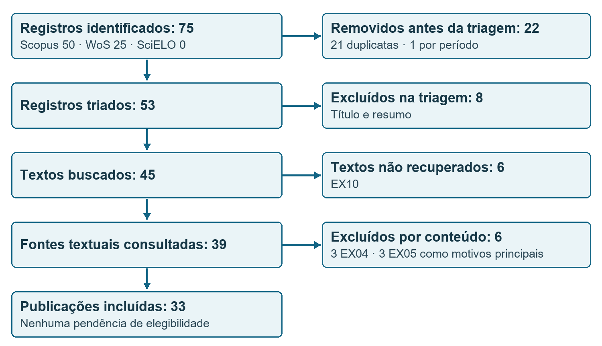
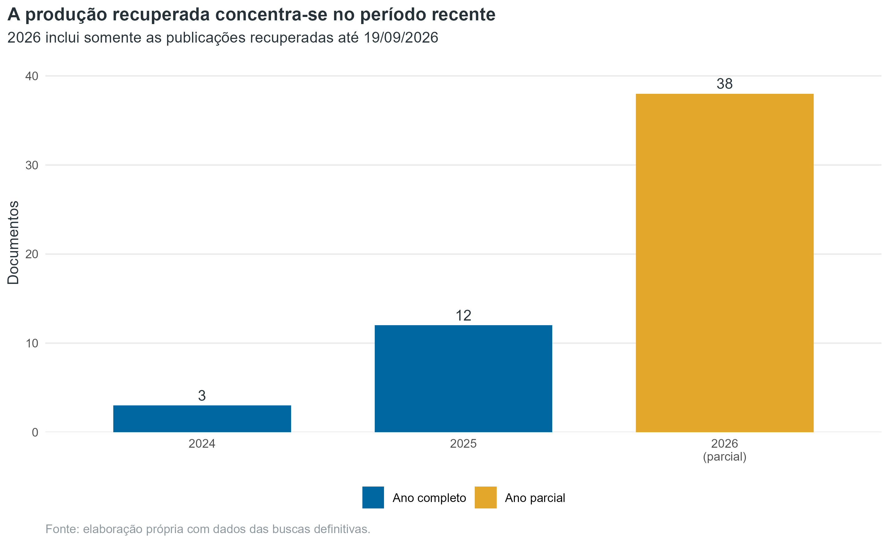
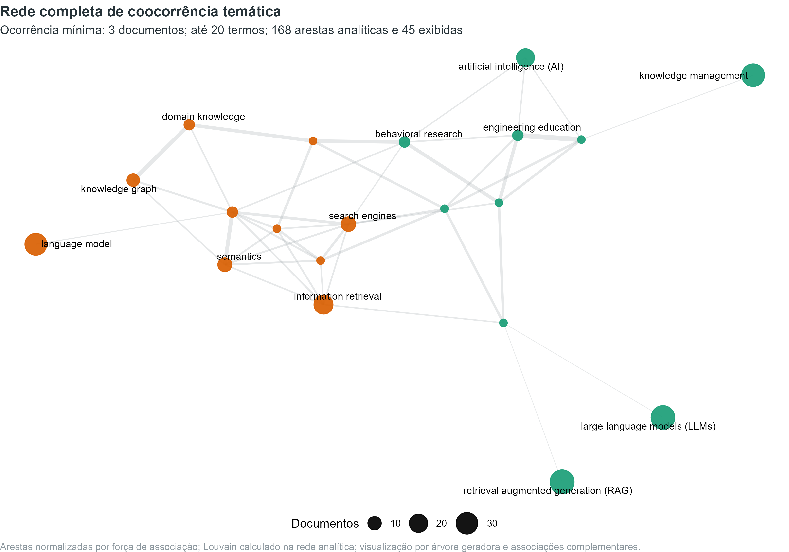
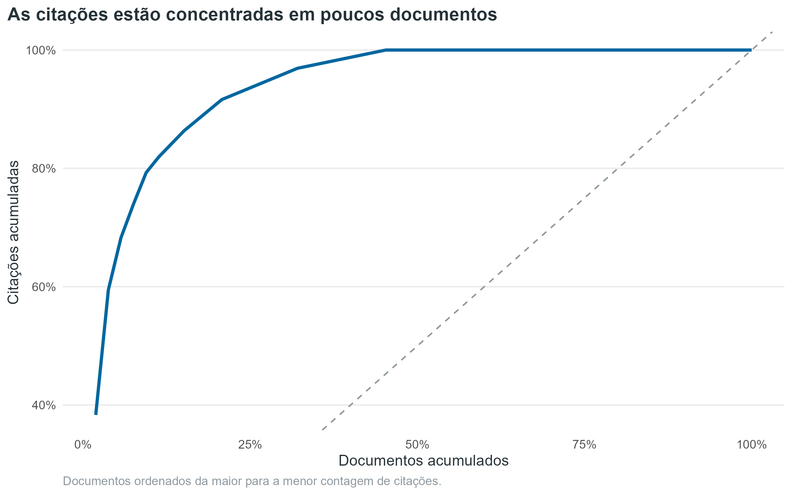

# Resumo {.unnumbered}

A dispersão de registros em sistemas e repositórios pode dificultar a recuperação do contexto necessário à reutilização do conhecimento organizacional. Investiguei como a inteligência artificial generativa (IAG) apoiada por *Retrieval-Augmented Generation* (RAG) pode complementar os sistemas de informação em processos administrativos, com atenção ao contexto educacional. Combinei bibliometria e revisão sistemática da literatura (RSL) a partir de buscas na Scopus, Web of Science e SciELO. Dos 75 registros identificados, 53 compuseram a base bibliométrica e passaram pela triagem. Busquei 45 textos, consultei 39 fontes textuais e incluí 33 publicações. A produção recuperada é recente, dispersa entre veículos e dependente da cobertura da Scopus. A RSL identificou aplicações em consultas, elaboração de documentos, recuperação contextual e reutilização de conhecimento. Benchmarks e avaliações locais sustentam resultados delimitados a tarefas e configurações específicas. Os desenhos e as métricas disponíveis oferecem evidência insuficiente de ganhos gerais de produtividade ou de qualidade decisória. A aplicação educacional requer avaliação situada, governança das fontes e supervisão humana. A condução individual, o acesso incompleto e a avaliação humana posterior à exposição às sugestões da IA limitam o alcance da síntese.

**Palavras-chave:** inteligência artificial generativa; geração aumentada por recuperação; memória organizacional; sistemas de informação; revisão sistemática da literatura.

# Introdução

## Contextualização e problema de pesquisa

As organizações utilizam sistemas de informação, bases de dados, documentos, repositórios e outros registros digitais para apoiar suas operações, documentar processos e preservar informações e conhecimentos produzidos ao longo do tempo. Esses recursos constituem parte relevante da infraestrutura informacional necessária à coordenação das atividades e à tomada de decisão.

Entretanto, a existência de registros e sistemas estruturados não implica que todo o contexto necessário à interpretação de uma situação esteja articulado em uma única fonte. Premissas, justificativas, regras, versões, vigências, históricos e decisões anteriores podem permanecer distribuídos entre diferentes ambientes. A literatura sobre gestão do conhecimento e memória organizacional indica que o conhecimento organizacional não se limita às informações formalmente codificadas e que sua utilização depende das condições em que pode ser localizado, recuperado e interpretado [@alavi2001knowledge; @jennex2003organizational].

A memória organizacional compreende mecanismos de aquisição, retenção, armazenamento, recuperação e disseminação do conhecimento para reutilização posterior. Ela pode envolver informações estruturadas, documentos, registros de processos, experiências e elementos interpretativos necessários à resolução de problemas e à tomada de decisão [@jennex2003organizational]. Reduzi-la a armazenamento documental desconsideraria as relações entre conteúdo, contexto, atores, processos e finalidade de uso.

Uma situação ilustrativa ajuda a delimitar o problema no contexto educacional. Considere o planejamento orçamentário anual de uma rede com mais de cem unidades escolares. Durante sua elaboração, equipes distintas atualizam, em momentos diferentes, projeções de matrículas, abertura ou encerramento de turmas, dimensionamento de profissionais, manutenção predial, obras, contratos, aquisições, transporte, alimentação, tecnologia e índices de inflação. Parte desses elementos está em sistemas corporativos; outra parte, em planilhas, resoluções, atas, pareceres, mensagens e versões anteriores do orçamento. Cada registro pode estar correto isoladamente, mas a decisão depende da articulação entre unidade, período, versão, vigência, autoridade, premissa utilizada e justificativas de alterações. O problema, nesse exemplo, não é apenas obter os dados, mas recuperar e comunicar o contexto distribuído que explica por que determinado valor, prioridade ou regra deve ser aplicado. O exemplo é ilustrativo e não constitui resultado empírico deste estudo.

Problema análogo foi observado em uma organização industrial baseada em projetos: embora houvesse um repositório de lições aprendidas, a busca por palavras-chave dificultava a recuperação e o reaproveitamento das experiências. Um protótipo de RAG testado com dados organizacionais reais melhorou a relevância e o ordenamento da recuperação e reduziu o esforço de leitura por meio de sínteses contextualizadas, mas seu desempenho permaneceu dependente da qualidade da documentação de origem [@rasmussen2026lessons]. O caso reforça que a existência de registros não garante, por si só, recuperação contextual ou aprendizagem organizacional.

Nesse cenário, o problema de Gestão de TI investigado consiste na **dificuldade de recuperar e utilizar de forma contextualizada informações e elementos da memória organizacional distribuídos entre sistemas de informação, documentos, repositórios e registros digitais**. O problema não pressupõe que os sistemas existentes sejam inadequados nem que devam ser substituídos. O interesse está na eventual desarticulação entre o registro disponível e o contexto necessário à sua interpretação e reutilização.

RAG combina modelos generativos com mecanismos de recuperação de conteúdos externos ao conhecimento paramétrico do modelo, incorporando as informações recuperadas ao processo de geração [@lewis2020retrieval; @gao2024retrieval]. Essa arquitetura cria possibilidades de integração entre modelos de linguagem e fontes organizacionais, mas não garante, por si só, qualidade, confiabilidade, segurança ou adequação decisória.

A IAG apoiada por RAG é, portanto, tratada como **possibilidade tecnológica a ser investigada**. O estudo busca compreender como a literatura caracteriza sua utilização como complemento aos sistemas de informação, incluindo aplicações, benefícios, limitações, riscos e requisitos de governança. Não se assume antecipadamente que a tecnologia resolva o problema, gere resultados superiores ou seja apropriada a qualquer contexto.

## Questões de pesquisa

A questão central do estudo é:

> ****

Para operacionalizar a investigação, a questão central é desdobrada em quatro questões secundárias:

**QS1 — Caracterização do corpus recuperado**

> 

**QS2 — Aplicações e complementaridade**

> 

**QS3 — Benefícios, limitações e riscos**

> 

**QS4 — Governança e aplicação educacional**

> 

## Proposição orientadora

> ****

A proposição funciona como orientação para a busca e a análise, não como hipótese submetida a aceitação ou rejeição estatística. A conclusão retoma a proposição à luz da síntese e explicita as condições e os limites das evidências.

## Objetivos

O objetivo geral é **analisar, por meio de estudo bibliométrico e Revisão Sistemática da Literatura, como a Inteligência Artificial Generativa apoiada por RAG vem sendo aplicada à recuperação da memória organizacional e à geração, comunicação e documentação de informações destinadas ao apoio à tomada de decisão em processos administrativos, com atenção às possibilidades de aplicação em organizações educacionais**.

Os objetivos específicos são:

1. mapear a estrutura e a distribuição temporal da produção científica recuperada sobre IAG, RAG, memória organizacional e processos administrativos, identificando autores, fontes, redes e temas de pesquisa;
2. sistematizar as aplicações, formas de complementaridade aos sistemas de informação, benefícios, limitações e riscos reportados no uso da IAG apoiada por RAG para recuperação contextual e geração, comunicação e documentação de informações destinadas à tomada de decisão;
3. identificar requisitos de governança e lacunas de pesquisa relevantes para a aplicação dessas soluções em processos administrativos educacionais.

| Objetivo específico | Questões atendidas | Procedimento principal |
|---|---|---|
| OE1 — Mapear o corpus recuperado | QS1 | Bibliometria |
| OE2 — Sistematizar aplicações e resultados | QS2 e QS3 | RSL |
| OE3 — Identificar governança e lacunas | QS4 | RSL e síntese crítica |

: Correspondência entre objetivos, questões e procedimentos. {#tbl-objetivos tbl-colwidths="[51, 20, 29]"}

## Relevância e contribuição do estudo

Do ponto de vista científico, o estudo aproxima uma literatura consolidada sobre sistemas de informação, conhecimento e memória organizacional de uma produção recente sobre modelos de linguagem e RAG. A existência e a extensão dessa articulação não são tratadas como lacuna já comprovada; constituem objetos a serem verificados pela bibliometria e pela RSL. Revisões estruturadas permitem organizar conhecimentos dispersos, avaliar o estado de um campo e identificar questões que demandam investigação adicional [@snyder2019literature].

A contribuição metodológica reside na integração proporcional de dois procedimentos. A bibliometria descreve a estrutura do corpus, seus atores, fontes, relações e temas; a RSL examina as evidências substantivas sobre aplicações, resultados, riscos e governança. Essa separação reduz o risco de inferir benefícios ou relações teóricas apenas a partir de frequências e redes bibliométricas [@zupic2015bibliometric; @donthu2021bibliometric].

Para a Gestão de TI, o estudo oferece subsídios para avaliar em que condições a IAG apoiada por RAG pode atuar como camada complementar aos sistemas de informação e às fontes existentes. A contribuição não consiste em recomendar previamente sua adoção, mas em organizar evidências sobre possibilidades, restrições, controles e responsabilidades necessários à avaliação da tecnologia em processos administrativos e educacionais.

# Fundamentação teórica

## Sistemas de informação, registros e contexto organizacional

Sistemas de informação apoiam o registro, o processamento, a integração e a disponibilização de dados e informações necessários às atividades organizacionais. Em iniciativas de gestão do conhecimento, esses sistemas podem contribuir para a criação, o armazenamento, a transferência e a aplicação do conhecimento, mas sua utilidade depende da articulação entre tecnologia, processos e práticas organizacionais [@alavi2001knowledge].

Dados correspondem a representações registradas; informações resultam de sua organização e interpretação em relação a uma finalidade; e conhecimento envolve a capacidade humana e organizacional de compreender, relacionar e utilizar essas informações em situações concretas. O contexto não constitui apenas outro campo informacional. Ele reúne relações que ajudam a determinar o significado e a aplicabilidade de um conteúdo, como origem, vigência, versão, autoridade, processo, ator responsável, momento de produção e finalidade de uso.

Uma informação registrada pode ser tecnicamente correta e, ainda assim, ser insuficiente para sustentar uma decisão quando está separada de suas premissas ou condições de validade. Em processos administrativos, dados estruturados coexistem com normas, documentos, pareceres, comunicações e experiências.

Por isso, o problema investigado não contrapõe sistemas formais e novos recursos tecnológicos. Ele examina como registros estruturados e não estruturados podem ser articulados de maneira controlada, preservando proveniência, vigência e autoridade.

## Gestão do conhecimento, aprendizagem e memória organizacional

A gestão do conhecimento abrange processos de criação, aquisição, armazenamento, recuperação, compartilhamento e aplicação do conhecimento. A aprendizagem organizacional, por sua vez, envolve a transformação de experiências e interpretações individuais ou coletivas em mudanças relativamente incorporadas às práticas, rotinas e estruturas da organização. A memória organizacional pode ser compreendida como resultado e suporte desse processo: ela reúne conteúdos e estruturas retidos que podem influenciar interpretações e ações futuras [@alavi2001knowledge; @antunes2020linking].

Sistemas de memória organizacional apoiam a aquisição, retenção, manutenção, busca e recuperação desses conteúdos, contribuindo para aprendizagem, resolução de problemas e tomada de decisão [@jennex2003organizational]. Barros et al. [-@barros2015information] mostram que essa memória não se limita a um repositório centralizado: pode permanecer distribuída entre sistemas, bases, documentos e atores.

Estudos posteriores reforçam que armazenar conteúdos não garante a preservação efetiva da memória. Modelos de implantação da gestão do conhecimento nem sempre incorporam adequadamente as características da memória organizacional, o que ajuda a explicar perdas de conhecimento e dificuldades de reutilização [@damian2021modelos]. Assim, a memória não corresponde simplesmente ao que foi armazenado, mas ao que a organização consegue reter, atualizar, localizar, interpretar e reutilizar.

Um estudo qualitativo em uma empresa brasileira de desenvolvimento de aplicativos mostra como pressão de tempo, centralização do conhecimento e dificuldades de codificação podem produzir uma **memória organizacional volátil**, dependente dos especialistas e vulnerável à perda antes de completar o ciclo de aprendizagem e institucionalização [@versiani2024volatile]. O caso evidencia que tecnologia, comportamento, estratégia e organização do trabalho participam conjuntamente da preservação da memória.

## Recuperação contextual e limitações dos sistemas de memória

Neste estudo, recuperação contextual designa a localização de conteúdos acompanhados das relações necessárias à sua interpretação e reutilização. Essas relações incluem, conforme o caso, a fonte, a versão, a data de vigência, a autoridade responsável, o processo que originou o registro, o histórico de alterações e as condições específicas às quais o conteúdo se aplica. Adotei essa definição para interpretar as aplicações descritas na RSL.

Mecanismos de busca lexical recuperam documentos principalmente por correspondência de termos. Essa estratégia pode ser insuficiente quando a consulta e o documento empregam vocabulários diferentes, quando a resposta depende da combinação de múltiplas fontes ou quando o registro relevante está cercado de versões e informações conflitantes. Métodos semânticos podem aproximar conteúdos por similaridade de significado, mas também podem recuperar itens apenas parcialmente aderentes e não resolvem, por si sós, problemas de autoridade, atualização ou completude.

Preservar e recuperar memória também não significa que o conteúdo recuperado seja atual ou apropriado. Sistemas de gestão do conhecimento podem reforçar práticas obsoletas por mecanismos como governança rígida, reforço algorítmico e falha na remoção de conhecimentos desatualizados; a revisão periódica e o questionamento das práticas vigentes são intervenções propostas na literatura [@njiru2025knowledge]. A recuperação contextual precisa, portanto, considerar tanto relevância quanto validade e proveniência.

## IAG apoiada por RAG como camada potencialmente complementar aos sistemas de informação

Modelos de linguagem geram respostas a partir de padrões aprendidos durante o treinamento, mas seu conhecimento paramétrico pode ser insuficiente, desatualizado ou inadequado para representar informações organizacionais específicas. RAG procura reduzir parte dessa limitação ao recuperar conteúdos externos aos parâmetros do modelo gerador e incorporá-los ao contexto de geração. Esses conteúdos podem provir de fontes internas à organização e integrar a própria arquitetura RAG; externo, aqui, não significa fora da empresa ou fora da solução [@lewis2020retrieval; @gao2024retrieval].

O processo pode ser descrito em cinco funções articuladas: recuperação de conteúdos candidatos; seleção ou reranqueamento das evidências; composição do contexto enviado ao modelo; geração da resposta; e apresentação das fontes que sustentam o resultado. Arquiteturas posteriores diversificaram componentes de indexação, segmentação, recuperação, reranqueamento e avaliação [@gao2024retrieval; @brown2025systematic].

Em ambientes organizacionais, as fontes recuperadas podem incluir bases documentais, normas, manuais, registros de processos, lições aprendidas e outros repositórios autorizados. Uma revisão voltada à gestão do conhecimento empresarial e automação documental confirma a rápida expansão dessas aplicações, mas também identifica heterogeneidade técnica e necessidade de maior validação em fluxos organizacionais reais [@karakurt2026enterprise].

A literatura recente enfatiza uma parceria entre pessoas e IA nos processos de criação, armazenamento, recuperação, compartilhamento e aplicação do conhecimento, e não a substituição dos atores organizacionais [@jarrahi2023partnership]. Storey [-@storey2025knowledge] discute como a IAG altera práticas de gestão do conhecimento, enquanto Böhm e Durst [-@bohm2026knowledge] propõem o modelo GRAI como extensão conceitual do SECI, atribuindo à máquina papel mais ativo na criação e circulação do conhecimento. Como contribuição conceitual, o GRAI orienta perguntas analíticas, mas não comprova isoladamente resultados organizacionais.

A recuperação externa não elimina problemas de qualidade. Respostas podem ser afetadas por documentos desatualizados, segmentação inadequada, recuperação insuficiente, conflitos entre fontes ou geração não sustentada. A aplicação de IAG apoiada por RAG é tratada, portanto, como uma camada potencialmente complementar aos sistemas de informação para acesso, articulação e síntese, enquanto autoridade, registro oficial e controles permanecem associados às fontes e aos processos organizacionais.

## Governança da informação, dos dados e da IA

O uso organizacional de IAG envolve dimensões que ultrapassam o desempenho técnico. Qualidade e atualidade das fontes, segurança, privacidade, transparência, rastreabilidade, responsabilidades e supervisão humana influenciam a confiabilidade do sistema e a possibilidade de utilizar suas respostas em processos decisórios [@nist2024generative; @nist2023airmf].

Em soluções baseadas em RAG, a governança precisa alcançar tanto o modelo quanto a base recuperada. Isso inclui definir fontes autorizadas, responsáveis pela atualização, controles de acesso, tratamento de conflitos, preservação de proveniência, registro das consultas e procedimentos de validação.

Evidência recente produzida por pesquisa de design em colaboração com uma universidade pública propõe sete princípios para a integração de IAG à gestão do conhecimento: privacidade e segurança desde o desenho; integração escalável com RAG; confiança e transparência; qualidade da base de conhecimento; centralidade no usuário; experiência de uso; e adequação ao caso de uso [@ruth2026design]. Esses princípios aproximam a discussão normativa das decisões concretas de implantação e são particularmente relevantes para organizações educacionais.

No âmbito da pesquisa, os mesmos princípios orientam o uso de IA como apoio metodológico. Integridade e rastreabilidade exigem que decisões acadêmicas permaneçam sob responsabilidade dos autores, com preservação das fontes e validação humana dos produtos relevantes [@cnpq2026integridade; @usp2025boaspraticas].

# Método

## Desenho da pesquisa

O estudo é classificado como pesquisa bibliográfica de orientação aplicada, caráter exploratório e descritivo, estruturada como estudo secundário com abordagem quantitativa e qualitativa. A orientação aplicada decorre do propósito de produzir subsídios para avaliação e governança de possíveis aplicações organizacionais, e não da implementação ou avaliação, nesta pesquisa, de um artefato tecnológico. Os dados são constituídos por metadados bibliográficos e pelas evidências extraídas dos estudos elegíveis.

A bibliometria responde prioritariamente à QS1 por meio de indicadores descritivos e relacionais. Empreguei a RSL nas QS2, QS3 e QS4 para identificar, avaliar, organizar e sintetizar aplicações, benefícios, limitações, riscos, requisitos de governança e lacunas.

A pesquisa é conduzida por protocolo previamente estruturado. O relato da identificação, seleção e inclusão dos estudos segue as orientações aplicáveis do PRISMA 2020, enquanto o registro das estratégias de busca observa o PRISMA-S [@page2021prisma; @page2021prismaexplained; @rethlefsen2021prismas].

O desenho integrou duas análises. Após as buscas, normalizei e dedupliquei os registros. A mesma base de 53 documentos alimentou a bibliometria e a seleção da RSL. Na revisão, calibrei a aplicação dos critérios em dez registros, completei a triagem dos demais, busquei os textos e decidi a elegibilidade. Em seguida, avaliei a qualidade, consolidei a extração e sintetizei as evidências. Integrei os resultados na discussão, mantendo as unidades de análise de cada etapa.

## Fontes de informação e estratégia de busca

Foram consultadas Scopus, Web of Science e SciELO. A escolha combinou cobertura multidisciplinar internacional com a presença da produção brasileira e latino-americana. Diferenças de cobertura entre bases foram consideradas na interpretação [@visser2021largescale].

A estratégia definitiva foi organizada em três blocos obrigatórios ligados pelo operador booleano AND:

1. tecnologia RAG;
2. memória, conhecimento ou contexto informacional;
3. contexto organizacional, institucional, administrativo ou de negócio.

Os testes-piloto P0–P8 foram executados na Scopus em 15/09/2026. Foram avaliados 190 resultados amostrais quanto a volume, aderência, ruído, terminologia emergente e recuperação de estudos conhecidos. Após refinamentos, as buscas definitivas foram encerradas em 19/09/2026.

| Base | Registros | Campos e filtros principais | Encaminhamento |
|---|---:|---|---|
| Scopus | 50 | Título, resumo e palavras-chave; artigo; ano anterior a 2027 | Consolidação |
| Web of Science | 25 | Adaptação aos campos disponíveis; artigo; ano anterior a 2027 | Um registro de 2027 removido da base derivada |
| SciELO | 0 | Todos os índices; artigo; três blocos conceituais | Resultado zero registrado |
| SciELO — controle | 2 | Busca tecnológica simplificada | Uso diagnóstico; não incorporados |

: Resultados das buscas definitivas. {#tbl-buscas tbl-colwidths="[17, 12, 43, 28]"}

As estratégias completas da Scopus e da Web of Science, copiadas conforme registradas no documento de estratégia, são apresentadas no Apêndice A. Para a SciELO, o apêndice preserva a configuração, o resultado zero e a busca de controle disponíveis. A expressão integral executada deverá ser transcrita diretamente da evidência original da plataforma antes da submissão do manuscrito, evitando sua reconstrução retrospectiva.

Não foram aplicadas restrições de idioma ou área temática. Também não foi estabelecido limite temporal inferior. A concentração entre 2024 e 2026 decorreu dos resultados recuperados, não de filtro inicial em 2024.

## Critérios de elegibilidade e seleção dos estudos


A elegibilidade da RSL foi estruturada em três núcleos básicos:

1. relação efetiva com RAG ou mecanismo funcionalmente compatível;
2. recuperação de conteúdo em fontes de informação para contextualizar a geração. O conteúdo recuperado é externo aos parâmetros do modelo gerador. As fontes podem ser internas à organização e integrar a própria arquitetura RAG;
3. contexto organizacional, institucional, administrativo ou de negócio.

A inclusão também exigiu relação funcional com informação, conhecimento ou memória organizacional (CI-04). A pertinência ao escopo (CI-05) foi examinada pela contribuição substantiva a pelo menos uma das questões QS2, QS3 ou QS4. A ausência dessa contribuição fundamenta CE-05/EX07. O ajuste fino isolado, sem recuperação pertinente de fontes, não atende a CI-02.

A seleção foi organizada em duas fases: título/resumo e texto completo. Conduzi a triagem dos 53 registros como único pesquisador responsável, com apoio declarado de IA. No fluxo efetivamente aplicado, recebi primeiro o resumo original, sua tradução de apoio e a sugestão da IA, acompanhada de critérios, evidências e incertezas; em seguida, registrei minha avaliação após exposição à sugestão e minha decisão final justificada. Preservei a saída original da IA e as mensagens humanas separadamente. Não houve avaliação cega, independência ou segundo revisor humano. As decisões foram **avançar**, **excluir** ou **dúvida**; avanços e dúvidas seguiram para a busca dos textos completos. Diferenças foram tratadas na conversa por esclarecimento e decisão humana, sem exclusão exclusivamente automática. A inclusão foi decidida na etapa de elegibilidade após a triagem.

A calibração foi realizada em dez registros intencionais e encerrada por decisão humana, com seis avançar, dois excluir e dois dúvida. Suas decisões foram aproveitadas por referência na triagem; os demais 43 registros receberam novas decisões, sem duplicar a contagem da amostra. A triagem foi encerrada em 03/11/2026 com 35 avançar, oito excluir e dez dúvida. A amostra não estima acurácia nem valida generalização. Os esclarecimentos posteriores do CI-02 e de CE-05/EX07 explicitam a fronteira dos parâmetros do gerador e a relação com o escopo, preservando códigos e lógica: uma contribuição a pelo menos uma de QS2, QS3 ou QS4 é suficiente; CI-01 a CI-04 permanecem obrigatórios. Não se alteraram as buscas de 19/09/2026 ou as decisões já tomadas. A atualização terminológica preservou os critérios aplicados e as decisões já registradas.

O relato distingue a condução individual, o apoio automatizado, as verificações e a exposição prévia efetivamente documentadas, conforme os itens 8 e 9 do PRISMA 2020 [@page2021prismaexplained]. A colaboração humano–IA fundamenta-se em transparência, supervisão e adequação ao contexto [@flemyng2025position]. A checagem adicional em fluxos de um revisor é contemplada em orientações para revisões rápidas [@gartlehner2025responsible], aqui adaptadas sem reclassificar a pesquisa. Estudos de extração mostram possibilidades e erros em modelos e domínios específicos [@motzfeldtjensen2025chatgpt]; não demonstram equivalência à dupla revisão humana neste corpus. Um estudo com o modelo especializado LEADS examinou colaboração entre especialistas e IA na seleção e extração de literatura médica; esse contexto difere da ferramenta e do domínio desta pesquisa [@wang2025humanai].

## Gerenciamento, normalização e deduplicação

As exportações originais foram preservadas antes de qualquer transformação. O tratamento utilizou como fontes principais o CSV da Scopus e o XLS da Web of Science; arquivos BibTeX foram mantidos como fontes auxiliares.

Os 75 registros brutos foram consolidados após a exclusão, em base derivada, do registro da WoS com ano final 2027. A deduplicação priorizou DOI normalizado, título normalizado, combinação de título, primeiro autor e ano, identificadores auxiliares e conferência manual de casos ambíguos.

Foram normalizados autores, palavras-chave, fontes por ISSN, idiomas, afiliações, países e campos de citação. A normalização preservou os valores originais e registrou decisões humanas, conflitos e regras aplicadas. Após a retirada de 21 sobreposições, o corpus bibliométrico foi constituído por  documentos únicos.

| Etapa | Quantidade |
|---|---:|
| Registros brutos da Scopus e WoS | 75 |
| Exclusão temporal na base derivada | 1 |
| Registros após o controle temporal | 74 |
| Sobreposições removidas | 21 |
| Documentos únicos | 53 |

: Constituição do corpus bibliométrico. {#tbl-corpus}

A base deduplicada alimentou a triagem e a bibliometria. Os dois resultados da busca de controle da SciELO tiveram finalidade diagnóstica e ficaram fora das contagens da seleção.

## Análise bibliométrica

A bibliometria foi executada por rotinas próprias em R, com ambiente controlado por renv, tratamento dos dados com tidyverse, análise de redes com igraph e visualização com ggraph. As análises foram selecionadas conforme sua contribuição à QS1 e a qualidade dos metadados [@donthu2021bibliometric].

Foram calculados indicadores de produção temporal, fontes, autores, colaboração, instituições, países, palavras-chave e citações. As fontes foram normalizadas por ISSN; os autores foram identificados prioritariamente por Scopus ID e, quando necessário, por nome normalizado e correspondência unívoca.

As palavras-chave dos autores, as indexadas e o conjunto combinado foram diagnosticados separadamente. O dicionário distinguiu equivalências terminológicas estritas de famílias conceituais relacionadas.

As redes temáticas utilizaram termos presentes em pelo menos três documentos e foram limitadas a 20 termos. A rede analítica preservou todas as coocorrências elegíveis, normalizadas por força de associação. As comunidades foram identificadas por Louvain, com resolução 1 e semente 20260922. A rede de visualização manteve os mesmos nós e comunidades, empregando árvore geradora mínima e as associações mais fortes até 45 arestas.

## Extração, qualidade e síntese

Organizei a extração por publicação, campo, evidência, localização e questão de pesquisa. A matriz cobre identidade, desenho, fontes, processos, arquitetura, complementaridade, benefícios, riscos, governança, contexto educacional e lacunas. Testei o instrumento em dois desenhos distintos (DOC_0002 e DOC_0028) e registrei dez julgamentos qualitativos fundamentados para cada publicação incluída. Mantive qualidade, intensidade temática e elegibilidade como dimensões distintas. Usei a intensidade não identificada, baixa, moderada ou alta para descrever a relação temática por bloco. A qualidade informou a interpretação dos resultados, sem soma de pontos ou corte retrospectivo [@kitchenham2007guidelines; @flemyng2025position].

Adotei síntese narrativa e temática, com comparação descritiva. Preservei desenho, unidade de análise, métrica e configuração, além de divergências e limites de relato. A heterogeneidade dos estudos impediu uma estimativa conjunta de efeito a partir das evidências extraídas. Distingui evidência educacional direta, transferência intersetorial condicionada e propostas para pesquisa futura.

## Rastreabilidade e uso de inteligência artificial

Preservei as estratégias de busca, os registros de seleção, os localizadores das evidências e as versões dos produtos. A execução bibliométrica usada neste artigo é a publicada sob o identificador 20260922-014915. Usei IA como apoio à tradução, leitura guiada, organização e conferência. Registrei o parecer automatizado e a decisão humana separadamente. Tomei as decisões de elegibilidade e validei os julgamentos, as classificações e a síntese nos escopos documentados.

# Resultados

## Seleção e constituição do corpus bibliométrico

O corpus bibliométrico contém  documentos únicos. A Scopus representa 50 documentos e a Web of Science, 24; 21 estão presentes nas duas bases, 29 são exclusivos da Scopus e três são exclusivos da Web of Science. A SciELO não recuperou registros com a estratégia definitiva. Assim, embora a combinação das bases tenha ampliado a cobertura, os resultados dependem fortemente da Scopus e não devem ser generalizados para toda a produção científica existente.

## Fluxo da revisão e matriz de extração

| Fase | Número |
|:---|---:|
| Registros identificados | 75 |
| Removidos por período | 1 |
| Duplicatas removidas | 21 |
| Registros triados | 53 |
| Excluídos na triagem | 8 |
| Textos buscados | 45 |
| Textos não recuperados | 6 |
| Fontes textuais consultadas | 39 |
| Excluídos por conteúdo | 6 |
| Publicações incluídas | **33** |

: Fluxo da seleção segundo as categorias aplicáveis do PRISMA 2020. {#tbl-fluxo-rsl}

{#fig-prisma-final width=100%}

A calibração integrou a triagem dos 53 registros. As 35 decisões de avançar e dez dúvidas totalizaram 45 candidatos à recuperação. Houve quatro diferenças entre a categoria proposta pela IA e minha decisão na triagem. O registro dessas diferenças é descritivo e foi produzido em sequência com exposição às sugestões.

Os textos não recuperados (EX10) foram DOC_0034, DOC_0035, DOC_0042, DOC_0050, DOC_0051 e DOC_0053. Entre os textos avaliados e excluídos por conteúdo, DOC_0003, DOC_0015 e DOC_0032 receberam EX05 como motivo principal e EX04 como complementar. DOC_0037, DOC_0046 e DOC_0048 receberam EX04 como principal e EX05 como complementar. EX04 indica ausência de contexto organizacional, institucional ou administrativo pertinente. EX05 indica ausência de relação funcional pertinente com informação ou conhecimento organizacional. Para DOC_0032, utilizei o corpo web preservado, pois o PDF local correspondia a outro artigo. A versão relacionada ao DOC_0051 não substituiu a publicação selecionada.

A elegibilidade encerrou-se com 33 publicações e zero pendências. As 900 linhas da matriz são registros de campos e evidências. O conjunto inclui 330 julgamentos qualitativos, dez por publicação, e 297 classificações temáticas, com justificativas, localizadores e vínculos às questões de pesquisa. A consolidação incorporou 31 linhas adicionais nos campos existentes. Cada publicação recebeu uma classificação de relação temática em cada um dos nove blocos. Das 297 classificações, 156 foram altas, 110 moderadas, quatro baixas e 27 não identificadas. Esses totais descrevem o enquadramento temático. A avaliação qualitativa das evidências permaneceu separada.

A registra o controle do estudo, B a identificação bibliográfica e C a caracterização metodológica. A intensidade temática aplica-se aos blocos D–L.

| Bloco da matriz | Questão | Alta | Moderada | Baixa | Não identificada | Exemplo |
|:---|:---:|:---:|:---:|:---:|:---:|:---:|
| D · Contexto organizacional | QS2 | 28 | 5 | 0 | 0 | DOC_0002 |
| E · Tecnologia e arquitetura | QS2 | 28 | 5 | 0 | 0 | DOC_0028 |
| F · Sistemas e fontes | QS2 | 26 | 7 | 0 | 0 | DOC_0044 |
| G · Aplicação e complementaridade | QS2 | 23 | 10 | 0 | 0 | DOC_0002 |
| H · Benefícios e resultados | QS3 | 30 | 3 | 0 | 0 | DOC_0017 |
| I · Limitações e riscos | QS3–QS4 | 6 | 27 | 0 | 0 | DOC_0017 |
| J · Governança | QS4 | 10 | 21 | 2 | 0 | DOC_0044 |
| K · Contexto educacional | QS4 | 5 | 0 | 1 | 27 | DOC_0023 |
| L · Lacunas e agenda | QS4 | 0 | 32 | 1 | 0 | DOC_0028 (M) |
| **Total** | | **156** | **110** | **4** | **27** | |

: Distribuição das classificações temáticas por bloco, questão de pesquisa e publicação ilustrativa. {#tbl-distribuicao-tematica tbl-colwidths="[31, 10, 7, 12, 8, 17, 15]"}

Os exemplos foram escolhidos entre as publicações com relação alta no bloco, exceto no bloco L, cujo exemplo tem relação moderada (M). Os identificadores remetem ao Apêndice B. Cada bloco tem 33 classificações, uma por publicação.

## Caracterização bibliométrica do corpus recuperado



Todos os registros foram classificados como artigos. Essa homogeneidade documental está diretamente relacionada aos filtros da estratégia de busca e não caracteriza necessariamente a totalidade da literatura sobre o tema. O predomínio do inglês também deve ser interpretado como característica do corpus recuperado, pois não houve restrição de idioma.

## Produção recuperada por ano

{#fig-producao-ano width=88%}

Foram recuperados três documentos de 2024, 12 de 2025 e 38 de 2026. A forte concentração em 2026 é compatível com a atualidade das aplicações de RAG, mas pode refletir simultaneamente a dinâmica de indexação das bases e a estratégia terminológica, que exige menção explícita a uma tecnologia recente.

O resultado demonstra **crescimento da produção recuperada**, não crescimento do campo científico em sentido amplo. A segunda conclusão exigiria uma série temporal mais longa, menor dependência de uma tecnologia nomeada recentemente e controles adicionais sobre cobertura e indexação. Por isso, não se calculou taxa composta de crescimento anual para uma série de apenas três anos, ainda incompleta em 2026. Essa é uma decisão analítica deste estudo diante das limitações da série. Donthu et al. [-@donthu2021bibliometric] orientam, em termos gerais, a definição do escopo e a escolha de técnicas compatíveis com os objetivos; não estabelecem uma regra específica de exclusão de CAGR para séries de três anos.

## Fontes, autoria e colaboração

Os  documentos estão distribuídos em 47 fontes normalizadas por ISSN. *IEEE Access* reúne três documentos, e quatro fontes reúnem dois documentos cada; as demais aparecem uma única vez. A produção recuperada apresenta, portanto, baixa recorrência de fontes, sem núcleo editorial evidente no corpus. Esse padrão pode representar dispersão temática, novidade do objeto ou efeito da estratégia de busca e do tamanho amostral.

A autoria é ainda mais dispersa. Dos 194 autores únicos, aproximadamente 190 aparecem em apenas um documento. Somente quatro autores são recorrentes: Abdulmuhsin, Rehman e Al Atraqchi, com três documentos cada, e Mjlae, com dois. A conclusão substantiva não é a existência de um grupo produtivo consolidado, mas a ausência de concentração autoral no corpus.

A normalização identificou 180 autores prioritariamente por Scopus ID e 14 apenas pelo nome, resultando em cobertura de identificadores de 92,8%. A correspondência entre chaves de identificador e de nome foi mantida para evitar dupla contagem entre registros da Scopus e documentos exclusivos da Web of Science. Variantes efetivamente unificadas, possíveis homônimos e casos não resolvidos foram preservados na auditoria da análise, pois a ausência de um identificador comum ainda impõe incerteza residual.

China, Estados Unidos e Malásia concentram as maiores participações no conjunto recuperado. Nove documentos apresentam colaboração internacional. Os resultados de instituições e países permanecem descritivos e preliminares: afiliações incompletas, múltiplas instituições por autor e diferenças de granularidade entre bases limitam comparações finas. Uma rede de coautoria somente deve ser interpretada quando os vínculos persistirem após a normalização integral.

## Estrutura temática e redes de coocorrência

As palavras-chave foram examinadas em três conjuntos: termos fornecidos pelos autores, termos indexados pelas bases e conjunto combinado deduplicado por documento. Essa separação evita tratar descritores atribuídos por sistemas de indexação como escolhas dos autores. O dicionário aplicou apenas equivalências estritas — por exemplo, siglas e formas extensas, singular e plural — e preservou relações apenas conceituais em camada distinta.

{#fig-rede-completa width=100%}



A rede analítica contém todas as coocorrências elegíveis entre termos presentes em pelo menos três documentos, limitada aos 20 termos selecionados, e utiliza força de associação. O particionamento foi calculado nessa rede. A representação visual preserva os mesmos nós e comunidades, mas exibe somente a árvore geradora mínima complementada pelas associações mais fortes até 45 arestas, com baixa opacidade, para reduzir sobreposição gráfica. Portanto, posições periféricas ou ausência de uma ligação na figura não equivalem a marginalidade ou inexistência de relação na rede analítica.

Os termos estruturantes previstos pela estratégia incluem *retrieval-augmented generation*, *large language models*, *knowledge management*, memória organizacional, sistemas de informação e contexto organizacional. Entre os 20 candidatos da rede, somente *retrieval-augmented generation* e *knowledge management* foram efetivamente encontrados e retirados na análise de sensibilidade. A denominação adequada é, assim, **rede de sensibilidade sem termos da estratégia de busca presentes entre as palavras-chave selecionadas**.

Os agrupamentos sugerem provisoriamente frentes de infraestrutura de recuperação; estruturação e contextualização do conhecimento; e adoção e aplicações. Termos relacionados a recuperação da informação, mecanismos de busca, semântica e processamento de consultas aproximam-se da primeira frente; grafos de conhecimento, conhecimento de domínio e modelos de linguagem, da segunda; inteligência artificial, pesquisa comportamental e educação em engenharia, da terceira. Esses rótulos descrevem agrupamentos da rede bibliométrica. RAG e modelos de linguagem permanecem transversais, mesmo quando sua posição gráfica parece periférica devido à normalização e ao corte visual de arestas.

O núcleo conceitual mais frequente — RAG, modelos de linguagem, recuperação da informação e gestão do conhecimento — é parcialmente previsível pela própria estratégia de busca. Ele não deve ser apresentado como descoberta independente. Os contextos aplicados, contudo, apontam diversidade em educação, sistemas corporativos, segurança, diagnóstico industrial, grafos de conhecimento, recuperação de informação e apoio à decisão.

## Citações e visibilidade

{#fig-citacoes width=88%}

As citações apresentam distribuição fortemente assimétrica. Dos  documentos, 29 não registram citações, equivalentes a 54,7% do corpus. A mediana é zero, o intervalo interquartil é dois e a média é 4,28 citações por documento. O documento mais citado reúne 87 citações, cerca de 38,3% do total observado, enquanto os cinco primeiros concentram 79,3%.

A média isolada não representa o desempenho típico. A visibilidade está altamente concentrada, padrão compatível com a juventude do corpus e com tempos desiguais de exposição. Citações por ano podem ser utilizadas apenas como indicador complementar. Para documentos de 2026, a divisão por um ano completo pode superestimar a taxa; na ausência consistente do mês de publicação, a limitação deve permanecer explícita.

## Resposta à QS1

Os indicadores caracterizam o corpus recuperado:

1. o corpus é recente e todos os documentos foram publicados entre 2024 e 2026;
2. a aparente aceleração representa crescimento da produção recuperada, não demonstração isolada de crescimento do campo científico;
3. a cobertura depende fortemente da Scopus, embora a Web of Science acrescente três registros exclusivos;
4. a produção apresenta elevada dispersão editorial e autoral, sem núcleo consolidado de fontes ou pesquisadores recorrentes;
5. o inglês predomina e todos os itens são artigos, padrões associados ao corpus e aos filtros utilizados;
6. a estrutura temática reproduz parte da interseção imposta pela estratégia de busca, mas revela contextos aplicados diversos;
7. a colaboração internacional aparece em parcela minoritária, e os resultados institucionais e geográficos ainda requerem cautela devido à qualidade dos metadados;
8. a visibilidade científica é altamente concentrada e condicionada pelo curto tempo de exposição.

## QS2 — Aplicações, fontes e complementaridade

As aplicações incluem consultas a bases corporativas, recuperação contextual de documentos, elaboração de minutas e cursos, atendimento e diagnóstico. Documentos, bases, grafos de conhecimento e ontologias sustentam a recuperação de maneiras diferentes. A complementaridade da aplicação de IAG apoiada por RAG aos sistemas existentes decorre de funções como localizar registros existentes, recompor contexto e incorporar a consulta às ferramentas de trabalho. No setor público, a orquestração multiagente apoiou a preparação e a revisão de minutas [@gtsiDOC0002]. Em outros contextos, o RAG foi combinado com grafos para atendimento e geração de consultas SQL [@gtsiDOC0028; @gtsiDOC0013]. A geração de cursos a partir de documentos e a promoção de leitura de acervos históricos ilustram formas distintas de reutilização [@gtsiDOC0019; @tan2025digitalreading]. A estruturação de dados empresariais em grafos também aparece como contribuição à organização do conhecimento [@xu2026knowledgeproliferation].

## QS3 — Benefícios, limitações e riscos

| Evidência | Resultado ou observação | Alcance |
|:---|:---|:---|
| Implantação em fluxos públicos [@gtsiDOC0002] | Estimativa autorrelatada de redução aproximada de 70% no tempo | Relato situado. A magnitude carece de medição comparativa independente. |
| Questionário com 496 respostas por conveniência [@gtsiDOC0006] | Associações estimadas por PLS-SEM | Evidência sobre percepções e relações no modelo. Causalidade e uso por logs ficaram fora da avaliação. |
| Avaliação controlada com 19 empregados [@gtsiDOC0017] | Melhoria na qualidade da execução da tarefa avaliada | Resultado de qualidade no teste, com quantidade de trabalho e operação em produção fora do alcance demonstrado. |
| Comparação em atendimento com grafo [@gtsiDOC0028] | Desempenho local em consultas reescritas e julgamento por GPT | Sensível às consultas, configurações e procedimento de avaliação. |
| Atendimento com cache [@gtsiDOC0043] | O acerto de cache pode evitar nova geração. | Separei o atendimento por cache de uma nova recuperação e geração. |
| Construção de benchmark [@gtsiDOC0052] | RAG integra a construção do benchmark. | Distingui a construção do benchmark dos modelos avaliados posteriormente. |

: Exemplos de resultados e limites de interpretação na RSL. {#tbl-evidencias-rsl tbl-colwidths="[30, 31, 39]"}

Separei desempenho da busca, sustentação e correção factual, qualidade da decisão, percepções e resultados experimentais. Latência e custos descrevem a infraestrutura ou a execução avaliada. O *Validator* de DOC_0001 é um agente baseado em LLM [@gtsiDOC0001]. A execução local pode limitar a exposição de dados em certas configurações, e as citações facilitam a inspeção, mas segurança e correção factual requerem verificação específica [@gtsiDOC0039; @gtsiDOC0044].

Preservei insuficiências de relato e divergências, entre elas a combinação de métricas publicada em DOC_0022 e a relação entre passagens relevantes por consulta e *Precision@5* em DOC_0019 [@gtsiDOC0022; @gtsiDOC0019]. Em DOC_0010, o cadastro e o DOI indicam fascículo 2s, enquanto o cabeçalho do exemplar indica 3s. Mantive a divergência documentada e a cautela com as alegações quantitativas [@gtsiDOC0010].

## QS4 — Governança e administração educacional

As evidências apontam para curadoria, revisão e atualização das fontes, controle de acesso, rastreabilidade e intervenção humana em pontos de responsabilidade. Organizei a documentação em três dimensões: origem, versão e contexto dos registros; funcionamento, avaliação e alterações do sistema; intervenção humana e responsabilidades. Curadoria por pesquisadores, documentação da construção de benchmarks e registro de limites de avaliação ilustram dimensões diferentes [@gtsiDOC0044; @gtsiDOC0052; @gtsiDOC0028]. A documentação apoia a inspeção. A correção das respostas e a qualidade das decisões dependem também das fontes, da configuração, do processo e de verificações adequadas.

Identifiquei cinco publicações com contexto educacional direto: DOC_0006, DOC_0016, DOC_0023, DOC_0027 e DOC_0038 [@gtsiDOC0006; @gtsiDOC0016; @gtsiDOC0023; @gtsiDOC0027; @gtsiDOC0038]. Elas abordam situações distintas, entre elas orientação de acadêmicos à adoção, busca documental e assistentes universitários. Para a administração educacional, os resultados de outros setores oferecem hipóteses condicionadas à natureza dos processos, responsabilidades, dados e recursos locais.

# Discussão

A bibliometria situa uma produção recente, distribuída entre fontes e concentrada na cobertura da Scopus. Parte da proximidade entre RAG, recuperação e gestão do conhecimento decorre dos termos da busca. A RSL acrescenta a análise das funções efetivamente descritas e da natureza da evidência. A proposição de que a IAG apoiada por RAG pode complementar os sistemas de informação encontra apoio nas aplicações de busca, consulta e elaboração de documentos. A força dessa conclusão se limita à viabilidade e aos resultados locais observados. A literatura recuperada oferece evidência insuficiente para atribuir ganhos gerais de produtividade ou qualidade decisória à adoção de IAG/RAG.

## Cultura e fluxos de trabalho

Os relatos de administração pública e atendimento em pequenas e médias empresas descrevem inserção da ferramenta em rotinas, elaboração e revisão de textos e redução de trocas entre aplicações [@gtsiDOC0002; @gtsiDOC0026]. A avaliação de aceitação em DOC_0026 contou com um participante-chave. Cultura organizacional e apoio técnico aparecem na fundamentação da adoção, assim como a cultura e o papel dos formadores aparecem no contexto de treinamento [@gtsiDOC0006; @gtsiDOC0033]. A evidência empírica é situada e não estabelece transformação cultural longitudinal generalizável.

## Sustentabilidade

No sentido ambiental, DOC_0005 apresenta cenários industriais sintéticos de energia e efluentes. DOC_0022 apresenta estimativas preliminares de energia em dispositivos de borda [@gtsiDOC0005; @gtsiDOC0022]. No sentido computacional, atualização de bases, reutilização de *embeddings* e cache podem reduzir operações em determinadas configurações [@gtsiDOC0044; @gtsiDOC0039; @gtsiDOC0043]. No sentido institucional e operacional, a continuidade depende da manutenção das fontes e da atribuição de responsabilidades. Menores custos e latência sustentam uma discussão operacional. O corpus oferece evidência insuficiente de redução de carbono ou de impacto ambiental real.

## Alternativas e complementaridades tecnológicas ao RAG {#sec-alternativas-rag}

As três fontes desta subseção complementam a fundamentação tecnológica da discussão e situam a agenda de pesquisa fora do corpus da RSL.

O RAG integra um conjunto de estratégias de adaptação dos modelos de linguagem, cuja combinação depende da tarefa e das características das fontes. O *fine-tuning* ajusta parâmetros do modelo por treinamento adicional, enquanto o RAG fornece informações externas recuperadas durante a geração da resposta. As duas estratégias podem ser complementares. O *Retrieval-Augmented Fine-Tuning* (RAFT) treina o modelo para utilizar documentos relevantes e desconsiderar documentos distratores [@zhang2024raft]. Os resultados nos conjuntos de dados examinados sustentam essa possibilidade de combinação, mas deixam em aberto a superioridade geral e a transferência de benefícios para processos administrativos educacionais.

Modelos com janelas de contexto longas permitem fornecer diretamente conjuntos maiores de documentos à geração. Nos cenários avaliados e com recursos suficientes, o contexto longo apresentou desempenho médio superior, enquanto o RAG apresentou vantagem de custo. O estudo também propôs encaminhar consultas entre recuperação e contexto longo [@li2024raglongcontext]. Esses resultados indicam alternativas de composição arquitetural, com desempenho condicionado às configurações examinadas. Para o problema desta pesquisa, proponho que a comparação considere também a atualização das fontes, os custos de processamento, o controle de acesso e a rastreabilidade das informações utilizadas.

A recuperação também pode integrar processos iterativos nos quais o modelo formula consultas e utiliza os resultados em etapas sucessivas. O Search-R1 emprega aprendizagem por reforço para treinar a interação com mecanismos de busca e foi avaliado em conjuntos de perguntas e respostas [@jin2025searchr1]. Os resultados experimentais descrevem uma ampliação da recuperação articulada à geração. A melhoria da qualidade decisória e a viabilidade operacional em organizações requerem avaliação própria. Como agenda futura, proponho comparar RAG convencional, combinações com *fine-tuning*, contexto longo e busca iterativa em tarefas administrativas equivalentes, distinguindo recuperação, correção factual, qualidade decisória, custo, latência e necessidade de revisão humana.

## Confiabilidade, validade e limitações

Conduzi a revisão individualmente e examinei as propostas da IA antes do julgamento humano, sem cegamento ou segundo avaliador humano independente. Fiz conferências focais e usei traduções assistidas. Permanecem relatos de conferência indireta em DOC_0015, DOC_0016, DOC_0049 e DOC_0052. Os suplementos S0–S34 de DOC_0005 ficaram fora da auditoria e seis publicações não foram recuperadas. O instrumento qualitativo foi testado para este estudo e carece de validação externa. Cobertura restrita às bases, data de corte, lacunas dos metadados e diferenças entre setores condicionam a generalização.

As 33 publicações reúnem desenhos primários e secundários. Contei uma vez o resultado primário do DOC_0011, que também aparece na revisão DOC_0018 [@gtsiDOC0011; @gtsiDOC0018]. Apliquei a mesma cautela aos resultados primários citados por DOC_0023 e DOC_0049 [@gtsiDOC0023; @gtsiDOC0049]. A auditoria de famílias de estudos foi focal. DOC_0006 cita DOC_0035, excluído por não recuperação. A identidade da amostra permanece indeterminada, e preservei a expressão “10, 321” no registro de origem sem interpretação. O fechamento da síntese corresponde à validação do escopo documentado, sem nova leitura integral independente dos originais.

# Conclusão

Em resposta à questão central, a literatura examinada indica que a IAG apoiada por RAG pode atuar como camada complementar aos sistemas de informação existentes na recuperação contextual da memória organizacional. Os estudos descrevem aplicações em consultas, elaboração de minutas e reúso de conhecimento, com resultados delimitados às tarefas e configurações avaliadas. Esses achados oferecem apoio à proposição orientadora. A aplicação depende da qualidade, da atualidade e da governança das fontes, do desenho da recuperação, da rastreabilidade e da revisão humana.

Para **QS1 e OE1**, a bibliometria caracterizou 53 documentos distribuídos por 47 fontes, com concentração da produção recuperada em 2026 até 19 de setembro e dependência da cobertura da Scopus. A distribuição descreve a produção recuperada pelas buscas e pelo recorte adotados.

Para **QS2, QS3 e OE2**, a revisão de 33 publicações mostrou como a recuperação contextual pode apoiar consultas, elaboração de documentos e reúso de fontes organizacionais. Os desenhos e as métricas examinados oferecem evidência de ganhos em tarefas específicas. O efeito sobre a produtividade geral e a qualidade decisória ainda precisa ser medido.

Para **QS4 e OE3**, a síntese identificou curadoria das fontes, documentação, rastreabilidade e revisão humana como condições para avaliar a aplicação. Os trabalhos em contextos educacionais e os achados de outros setores orientam hipóteses de uso. A aplicação na administração educacional requer verificação no processo específico em que será utilizada.

Estudos futuros podem adotar a busca convencional como referência para comparar as estratégias discutidas, com fontes versionadas, critérios explícitos e responsabilidades definidas. A avaliação pode medir recuperação, correção factual, qualidade decisória, custo, latência e esforço de revisão humana, além de acompanhar adoção e manutenção ao longo do tempo.

# Declaração de uso de inteligência artificial {.unnumbered}

Utilizei o Codex (OpenAI) em atividades documentadas de revisão da estratégia, programação, organização e conferência dos registros, tradução pontual, leitura guiada, preparação de pareceres, síntese e redação assistida. A ferramenta apoiou a identificação e, quando disponível, a localização de evidências a conferir. Mantive os registros de propostas, evidências e decisões. Examinei as sugestões antes de decidir e assumi a responsabilidade pela seleção, avaliação e interpretação. A documentação do projeto registra o escopo de cada validação, os limites do acesso e as conferências efetuadas [@flemyng2025position; @usp2025boaspraticas; @cnpq2026integridade].


# Apêndice A — Estratégias definitivas de busca {.unnumbered}

Este apêndice reúne as estratégias definitivas disponíveis e seus parâmetros de execução. As expressões da Scopus e da Web of Science foram copiadas do registro metodológico sem simplificação dos blocos booleanos. Quebras de linha foram acrescentadas apenas para legibilidade. A estratégia da SciELO é documentada nos limites do registro atualmente preservado.

## Scopus {.unnumbered}

| Elemento | Registro |
|---|---|
| Base | Scopus |
| Campo | `TITLE-ABS-KEY` |
| Limite temporal | `PUBYEAR < 2027` |
| Tipo documental | Artigo — `DOCTYPE(ar)` |
| Idioma e área | Sem restrição |
| Data da execução final | 19/09/2026 |
| Registros recuperados | 50 |

: Configuração da busca definitiva na Scopus. {#tbl-apendice-scopus}

```text
TITLE-ABS-KEY(
  (
    "retrieval-augmented generation"
    OR "retrieval augmented generation"
  )
  AND
  (
    "organizational memory" OR "organisational memory"
    OR "corporate memory" OR "institutional memory"
    OR "organizational knowledge" OR "organisational knowledge"
    OR "institutional knowledge" OR "enterprise knowledge"
    OR "knowledge management"
    OR "knowledge repository" OR "knowledge repositories"
    OR "institutional repository" OR "institutional repositories"
    OR "organizational information" OR "organisational information"
  )
  AND
  (
    organization* OR organisation* OR institution* OR enterprise*
    OR "administrative process" OR "administrative processes"
    OR "administrative task" OR "administrative tasks"
    OR "administrative workflow" OR "administrative workflows"
    OR "business process" OR "business processes"
    OR "organizational process" OR "organizational processes"
    OR "organisational process" OR "organisational processes"
    OR "educational administration" OR "academic administration"
    OR "school administration" OR "school management"
    OR "education management" OR "higher education"
    OR "university administration" OR "university management"
  )
)
AND PUBYEAR < 2027
AND DOCTYPE(ar)
```

## Web of Science {.unnumbered}

| Elemento | Registro |
|---|---|
| Base | Web of Science Core Collection |
| Campo/ambiente | Campos disponíveis no ambiente da Core Collection |
| Tipo documental | Artigo, aplicado na interface |
| Idioma e área | Sem restrição |
| Data da execução | 19/09/2026 |
| Data registrada no XLS | 16/09/2026 |
| Registros exportados | 25 |
| Controle temporal posterior | Um registro com ano final 2027 retirado da base derivada |

: Configuração da busca definitiva na Web of Science. {#tbl-apendice-wos}

```text
(
  "retrieval-augmented generation"
  OR "retrieval augmented generation"
)
AND
(
  "organizational memory" OR "organisational memory"
  OR "corporate memory" OR "institutional memory"
  OR "organizational knowledge" OR "organisational knowledge"
  OR "institutional knowledge" OR "enterprise knowledge"
  OR "knowledge management"
  OR "knowledge repository" OR "knowledge repositories"
  OR "institutional repository" OR "institutional repositories"
  OR "organizational information" OR "organisational information"
)
AND
(
  organization* OR organisation* OR institution* OR enterprise*
  OR "administrative process" OR "administrative processes"
  OR "administrative task" OR "administrative tasks"
  OR "administrative workflow" OR "administrative workflows"
  OR "business process" OR "business processes"
  OR "organizational process" OR "organizational processes"
  OR "organisational process" OR "organisational processes"
  OR "educational administration" OR "academic administration"
  OR "school administration" OR "school management"
  OR "education management" OR "higher education"
  OR "university administration" OR "university management"
)
```

O tipo documental foi aplicado pela interface, pois o ambiente disponível não aceitou integralmente os qualificadores empregados na Scopus. Os 25 registros foram preservados na base bruta. A retirada do documento com ano final 2027 ocorreu posteriormente, durante a consolidação, sem alteração da exportação original.

## SciELO {.unnumbered}

Foi utilizada a string consolidada da Scopus, adaptada à estrutura da SciELO, com resultado zero. Posteriormente, a busca simples por “retrieval-augmented generation” recuperou dois artigos, de aplicações agrícola e clínica, fora da temática da pesquisa. Esses resultados de controle não foram incorporados ao corpus.

| Elemento | Registro |
|---|---|
| Base | SciELO |
| Campo | Todos os índices |
| Estrutura conceitual | Três blocos: tecnologia RAG; memória ou conhecimento organizacional; contexto organizacional ou administrativo |
| Tipo documental | Artigo |
| Data da execução | 19/09/2026 |
| Registros recuperados | 0 |
| Evidência preservada | `DEFINITIVA_SCIELO_V01_01_resultado_zero.pdf` |

: Configuração registrada para a busca definitiva na SciELO. {#tbl-apendice-scielo}

O documento metodológico preserva a configuração, a estrutura conceitual e o resultado zero, mas não transcreve a expressão integral inserida no formulário da SciELO. Para não apresentar como original uma string reconstruída posteriormente, a expressão não é reproduzida neste apêndice. A configuração e o resultado documentados delimitam o que é possível reproduzir a partir deste registro.

Como verificação diagnóstica, foi executada em “Todos os índices” a seguinte busca de controle:

```text
"retrieval-augmented generation"
```

A busca de controle recuperou dois documentos, ambos excluídos por não atenderem à interseção temática do estudo. Esses registros não integraram o corpus nem as contagens do fluxo PRISMA.

# Apêndice B — Publicações incluídas {.unnumbered}

O identificador vincula cada publicação às linhas correspondentes da matriz.

- DOC_0001 [@gtsiDOC0001]
- DOC_0002 [@gtsiDOC0002]
- DOC_0004 [@gtsiDOC0004]
- DOC_0005 [@gtsiDOC0005]
- DOC_0006 [@gtsiDOC0006]
- DOC_0007 [@gtsiDOC0007]
- DOC_0008 [@xu2026knowledgeproliferation]
- DOC_0009 [@gtsiDOC0009]
- DOC_0010 [@gtsiDOC0010]
- DOC_0011 [@gtsiDOC0011]
- DOC_0012 [@gtsiDOC0012]
- DOC_0013 [@gtsiDOC0013]
- DOC_0016 [@gtsiDOC0016]
- DOC_0017 [@gtsiDOC0017]
- DOC_0018 [@gtsiDOC0018]
- DOC_0019 [@gtsiDOC0019]
- DOC_0021 [@tan2025digitalreading]
- DOC_0022 [@gtsiDOC0022]
- DOC_0023 [@gtsiDOC0023]
- DOC_0026 [@gtsiDOC0026]
- DOC_0027 [@gtsiDOC0027]
- DOC_0028 [@gtsiDOC0028]
- DOC_0030 [@gtsiDOC0030]
- DOC_0033 [@gtsiDOC0033]
- DOC_0036 [@gtsiDOC0036]
- DOC_0038 [@gtsiDOC0038]
- DOC_0039 [@gtsiDOC0039]
- DOC_0041 [@gtsiDOC0041]
- DOC_0043 [@gtsiDOC0043]
- DOC_0044 [@gtsiDOC0044]
- DOC_0047 [@gtsiDOC0047]
- DOC_0049 [@gtsiDOC0049]
- DOC_0052 [@gtsiDOC0052]

# Referências {.unnumbered}
