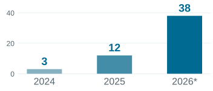

## Recuperação contextual da memória organizacional com IAG e RAG {.cover-slide}

Bibliometria e revisão sistemática em processos administrativos e educacionais

<strong></strong> Mestrado Profissional em Gestão e Tecnologia de Sistemas Produtivos Gestão da Tecnologia e Sistemas de Informação  <strong>Apresentação final · 24 de novembro de 2026</strong>

## O projeto

Título provisório
<strong></strong>

Questão central

Quais benefícios, limitações, riscos e requisitos de governança a literatura identifica no uso da IAG apoiada por RAG como complemento aos sistemas de informação para recuperar a memória organizacional e apoiar decisões administrativas?

:::: {.columns}
::: {.column width="50%"}

<h3>Proposição orientadora</h3>



:::

::: {.column width="50%"}

<h3>Objetivo</h3>

Analisar a produção recuperada e sintetizar aplicações, benefícios, limitações, riscos e requisitos de governança, com atenção ao contexto educacional.

:::
::::

OE1 e QS1: bibliometria · OE2–OE3 e QS2–QS4: revisão sistemática

<h3>Objetivos específicos</h3>

<strong>OE1.</strong> 

<strong>OE2.</strong> 

<strong>OE3.</strong> 

## Fundamentação

A memória organizacional depende do que a organização consegue <strong>reter, atualizar, localizar, interpretar e reutilizar</strong>, e não apenas do que foi armazenado.

:::: {.columns}
::: {.column width="48%"}

<h3>Linha conceitual</h3>

::: {.compact-list}

- **@alavi2001knowledge**: sistemas e processos de gestão do conhecimento.
- **@jennex2003organizational**: recuperação e uso da memória organizacional.
- **@barros2015information**: memória distribuída entre sistemas, documentos e atores.
- **@antunes2020linking**: aprendizagem como processo e memória como retenção.
- **@versiani2024volatile**: memória volátil quando o conhecimento permanece dependente de especialistas.

:::

:::

::: {.column width="52%"}

<h3>Problema observado em uma organização</h3>

Em um repositório industrial de lições aprendidas, a busca lexical dificultava o reaproveitamento das experiências. Um protótipo RAG melhorou a relevância e a ordenação dos resultados, mas continuou dependente da qualidade da documentação de origem.

::: {.small-source}
@rasmussen2026lessons
:::

<strong>Situação ilustrativa do projeto:</strong> planejamento orçamentário de uma rede educacional com fontes, versões e premissas distribuídas.

:::
::::

## Metodologia {.short-slide .method-slide}

Pesquisa bibliográfica aplicada, exploratória e descritiva, com abordagem quantitativa e qualitativa.

<h3>Bibliometria · QS1</h3>
53 documentos

Estrutura e distribuição temporal do corpus recuperado.

<h3>RSL · QS2–QS4</h3>
33 publicações

Aplicações, resultados, limites e governança.

Busca<small>75 → 53</small>

→

Bibliometria<small>Concluída</small>

→

Triagem<small>Concluída</small>

→

Textos completos<small>39 fontes consultadas</small>

→

Qualidade e extração

→

Síntese

IA apoia tradução, parecer e organização; eu confiro as evidências e decido. Não substitui um segundo pesquisador humano. PRISMA orienta o relato. [@page2021prisma; @flemyng2025position]

## Bibliometria {.short-slide .biblio-slide}

Pilotos P0–P8<small>Refinamento da estratégia</small>

→

Busca · 19/09<small>Scopus 50 · WoS 25 · SciELO 0</small>

→

Consolidação<small>− 1 de 2027 − 21 duplicatas</small>

→

53 documentos<small>Resultados preservados</small>

| Bloco de busca | Função |
|---|---|
| RAG por extenso | Delimitar a tecnologia |
| Memória / conhecimento / informação | Delimitar o conteúdo recuperado |
| Contexto organizacional | Aproximar a aplicação institucional |

47

fontes

194

autores únicos

Documentos por ano

35 / 53

família gestão do conhecimento

*2026 parcial, corte em 19/09. Famílias não exclusivas. Valores descrevem este corpus; não demonstram crescimento do campo ou eficácia das aplicações. [@donthu2021bibliometric]

## Revisão Sistemática da Literatura — apoio da IA {.ai-slide}

<strong>Condução individual com responsabilidade humana.</strong> Human-in-the-loop: eu leio, confiro as evidências, corrijo interpretações e decido. A IA apoia a compreensão e a organização; não é segundo pesquisador.

1 · Saída original da IA<small>Original + tradução; parecer, critérios, evidências e incertezas</small>

→

2 · Minha avaliação<small>Após exposição à IA; conferência, ressalvas e correções</small>

→

3 · Minha decisão e registro<small>Eu decido e confiro; IA transcreve e tabula</small>

Dúvidas e correções retornam à IA; eu reconfiro antes de concluir o registro.

::: {.dense}
| Fundamentação | Aplicação e limite |
|---|---|
| @flemyng2025position | Responsabilidade, supervisão humana, transparência e teste no contexto de uso. |
| @gartlehner2025responsible | Verificar saídas; fonte sobre revisões rápidas, sem converter esta RSL em revisão rápida. |
| @motzfeldtjensen2025chatgpt; @wang2025humanai | Estudos em tarefas/domínios específicos; não comprovam desempenho equivalente neste corpus. |
:::

  <strong>Nacional:</strong> CNPq (2026), art. 9º: declaração de ferramenta/finalidade e responsabilidade pelo conteúdo.
   
  <strong>Internacional:</strong> NIST (2023), AI RMF 1.0: gestão documentada dos riscos. Referências de apoio conforme seus escopos, sem certificação de conformidade.

Fluxo efetivamente aplicado: IA primeiro → avaliação humana após exposição → decisão humana. Três registros, um pesquisador; sem independência ou cegamento. Concordância não é prova de acurácia. Prompts, versões, evidências e correções são preservados.

## Revisão Sistemática da Literatura — critérios {.criteria-slide}

:::: {.columns .status-columns .criteria-columns}
::: {.column width="50%"}

### Inclusão — critérios existentes

::: {.dense}
| Código | O que verificar |
|---|---|
| CI-01 | RAG ou mecanismo funcionalmente compatível. |
| CI-02 | Recuperação de conteúdo externo aos parâmetros do gerador, para contextualizar a geração. |
| CI-03 | Contexto organizacional, institucional ou administrativo. |
| CI-04 | Relação funcional com informação, conhecimento ou memória organizacional. |
| CI-05 | Contribuição substantiva a pelo menos uma de QS2, QS3 ou QS4. |
| CI-06–09 | Artigo; sem restrição de idioma; antes de 2027; informações disponíveis. |
:::

:::
::: {.column width="50%"}

### Exclusão — critérios e motivos

::: {.dense}
| CE / EX | Ausência ou condição verificável |
|---|---|
| CE-01 / EX01–02 | Sem RAG compatível; sigla com outro sentido. |
| CE-02 / EX03 | Sem recuperação de fontes pertinente à geração. |
| CE-03 / EX04 | Sem contexto organizacional relevante. |
| EX05 / CI-04 | Sem vínculo funcional com informação/conhecimento organizacional. |
| CE-04 / EX06 | Aplicação exclusivamente pedagógica. |
| CE-05 / EX07 | Sem relação substantiva com o escopo da pesquisa. |
| CE-07 / EX10 | Texto completo não recuperado após tentativas. |
| CE-06, 08 e 09 | Tipo não elegível, redundância ou informação insuficiente. |
:::

:::
::::

<strong>O QUE CONTA COMO FONTE</strong>Um repositório interno ou privado pode fornecer conteúdo externo aos parâmetros do modelo. O ajuste fino isolado não atende a CI-02.

<strong>CI</strong> = critério de inclusão. <strong>CE</strong> = critério de exclusão. <strong>EX</strong> = código do motivo registrado. Exemplo: CE-07 define a condição; EX10 registra o motivo no fluxo. EX09 é o código do filtro de período. Ausência no resumo não demonstra ausência no texto.

## Revisão Sistemática da Literatura — calibração e triagem {.triagem-slide .triagem-central}

| Rodada | Registros com decisão | Avançar | Excluir | Dúvida | Situação |
|---|---:|---:|---:|---:|---|
| Calibração | 10 | 6 | 2 | 2 | ✅ Concluída |
| Triagem — demais registros | 43 | 29 | 6 | 8 | ✅ Concluída |
| Total, sem duplicar a calibração | **53** | **35** | **8** | **10** | **45 candidatos ao integral** |

## Revisão Sistemática da Literatura — matriz de análise {.short-slide .matrix-slide}

| Bloco | Foco da análise | Relação temática | Justificativa | Localização da evidência |
|---|---|---|---|---|
| Identidade e método | Contexto, desenho, amostra e comparação | Não se aplica | Caracterização do estudo | Página / seção |
| Aplicação e tecnologia | Processo, fontes, RAG e integração | Nível registrado por bloco | Como contribui para QS2 | Trecho e página |
| Resultados | Benefícios, medidas e limitações | Nível registrado por bloco | O que sustenta para QS3 | Página / tabela |
| Limites e governança | Riscos, validação e responsabilidades | Nível registrado por bloco | Contribuição a QS3–QS4 | Página / seção |
| Relação com a pesquisa | QS2–QS4 e transferência educacional | Nível registrado por bloco | Vínculo e limite da contribuição | Trecho e página |
| Evidência e conferência | Fonte e verificação humana | Não se aplica | Rastreabilidade do registro | Página / seção |

<strong>Não identificada</strong><small>Evidência não localizada no texto</small>

<strong>Baixa</strong><small>Menção periférica</small>

<strong>Moderada</strong><small>Contribuição explícita e secundária</small>

<strong>Alta</strong><small>Tema central desenvolvido</small>

<strong>Matriz consolidada:</strong> 900 linhas, 330 julgamentos qualitativos e 297 classificações temáticas. Foram incorporadas 31 linhas adicionais.

Relação temática não é qualidade metodológica, escore ou corte de inclusão. Não identificada não comprova inexistência. Elegibilidade e conferência humanas permanecem individuais. [@kitchenham2007guidelines; @page2021prisma]

## Revisão Sistemática da Literatura — avaliação e matriz preenchida {.short-slide .rsl-novos-dados .exemplo-integral}

Original conferido<small>Identidade e versão</small>

→

IA: tradução e parecer<small>Tradução focal e parecer</small>

→

IA: leitura guiada<small>Evidências, limites e pontos de conferência</small>

→

Eu: conferência e decisão<small>Elegibilidade encerrada</small>

→

Tabulação conferida<small>Após elegibilidade</small>

| bloco | campo | valor | pagina_secao_tabela | qs_relacionada | relacao_tematica |
|:---|:---|:---|:---|:---:|:---:|
| A — Controle | id_registro_origem | DOC_0002 | p. PDF 1; controle de candidatos | Não se aplica | Não se aplica |
| A — Controle | status_extracao | Em andamento; elegibilidade humana Incluir; conferência de campos/qualidade pendente | p. PDF 1; controle de candidatos | Não se aplica | Não se aplica |
| B — Identificação bibliográfica | titulo | Transforming public administration workflows with multi-agent AI: A human-in-the-loop knowledge orchestration framework | p. PDF 1; controle de candidatos | Não se aplica | Não se aplica |
| B — Identificação bibliográfica | doi | 10.1016/j.chbr.2026.101253 | p. PDF 1; controle de candidatos | Não se aplica | Não se aplica |
| C — Caracterização metodológica | desenho | Implantação naturalística em uma administração; observação e entrevistas; sem controle aleatorizado | p. PDF 7; §5.2; E4; conferir também as páginas no guia | QS3 | Não se aplica |
| C — Caracterização metodológica | amostra | 30 usuários ativos; 112 solicitações; uma instituição; subconjunto de entrevistados não quantificado | §5.1 e Tabela3, PDFp.7:30usuários/112solicitações; entrevistas §5.2, pp.7–8 | QS3 | Não se aplica |
| C — Caracterização metodológica | periodo_estudo | Seis meses; datas exatas da operação não confirmadas nesta rodada | Tabela3 e §5.1, PDFp.7 | QS3 | Não se aplica |
| D — Contexto organizacional | setor | Administração pública regional; Província Autônoma de Trento, Itália | p. PDF 5; §3.2; E1; conferir também as páginas no guia \| Relação temática: §5.1 e Tabela 3, p. 7 | QS2 | Alta |
| D — Contexto organizacional | processo | Preparação de respostas a solicitações do conselho e coordenação de competências | p. PDF 5; §3.2; E1; conferir também as páginas no guia \| Relação temática: §5.1 e Tabela 3, p. 7 | QS2 | Alta |
| E — Tecnologia e arquitetura | arquitetura_rag | CARE: orquestração LangGraph com agentes especializados, recuperação híbrida e revisão delimitada | p. PDF 5; §3.3; E2; conferir também as páginas no guia \| Relação temática: §3.1–3.5, pp. 4–5; §4, pp. 5–7; §6.3, p. 10 | QS2 | Alta |
| E — Tecnologia e arquitetura | tipo_recuperacao | Densa e esparsa, fusão e filtro de pertinência por LLM (§3.3) | p. PDF 5; §3.3; E2; conferir também as páginas no guia \| Relação temática: §3.1–3.5, pp. 4–5; §4, pp. 5–7; §6.3, p. 10 | QS2 | Alta |
| E — Tecnologia e arquitetura | modelo | GPT-4o segundo Apêndice A.10; checkpoint não informado | p. PDF 11; Ethics declaration; E6; conferir também as páginas no guia \| Relação temática: §3.1–3.5, pp. 4–5; §4, pp. 5–7; §6.3, p. 10 | QS2 | Alta |
| F — Sistemas e fontes organizacionais | fontes_recuperadas | Mais de 160 mil documentos administrativos e respostas anteriores; fontes internas/oficiais | p. PDF 5; §3.2; E1; conferir também as páginas no guia \| Relação temática: §3.2, pp. 4–5 | QS2 | Alta |
| F — Sistemas e fontes organizacionais | memoria_organizacional | Função explícita do acervo institucional na preparação de respostas | p. PDF 5; §3.2; E1; conferir também as páginas no guia \| Relação temática: §3.2, pp. 4–5 | QS2 | Alta |
| G — Aplicação e complementaridade | forma_complementaridade | Recuperar, sintetizar e redigir minuta mantendo revisão e aprovação administrativas | p. PDF 7; §5.1; E3; conferir também as páginas no guia | QS2 | Alta |
| H — Benefícios e resultados | resultado_quantitativo | Aproximadamente 70% de redução de tempo: estimativa agregada por autoavaliação | p. PDF 7; §5.2; E4; conferir também as páginas no guia \| Relação temática: Tabela 3 e §5.2, p. 7; §6.3, p. 10 | QS3 | Alta |
| H — Benefícios e resultados | forca_afirmacao | Relato de implantação e percepção; não demonstra efeito causal ou ganho reproduzível | p. PDF 7; §5.2; E4; conferir também as páginas no guia \| Relação temática: Tabela 3 e §5.2, p. 7; §6.3, p. 10 | QS3 | Alta |
| I — Limitações e riscos | limitacao_metodologica | Sem controle, cronometragem uniforme ou taxas sistemáticas de alucinação/citação | p. PDF 8; §5.3; E5; conferir também as páginas no guia \| Relação temática: §6.3–6.5, p. 10 | QS3 | Moderada |
| I — Limitações e riscos | risco | Afirmações incorretas podem sobreviver à recuperação; responsabilidade não delegável | p. PDF 8; §5.3; E5; conferir também as páginas no guia \| Relação temática: §6.3–6.5, p. 10 | QS3; QS4 | Moderada |
| J — Governança | validacao_humana | Revisão documental e assinatura administrativa obrigatórias antes da liberação | p. PDF 7; §5.1; E3; conferir também as páginas no guia | QS4 | Alta |
| J — Governança | rastreabilidade | Referências e artefatos intermediários descritos; eficácia isolada não mensurada | p. PDF 8; §5.3; E5; conferir também as páginas no guia \| Relação temática: p. PDF 7; §5.1; E3; conferir também as páginas no guia | QS4 | Alta |
| K — Contexto educacional | aplicacao_direta | Não há aplicação educacional testada | p. PDF 10; §6.4; E7; conferir também as páginas no guia \| Relação temática: §5.1 e Tabela 3, p. 7 | QS4 | Não identificada |
| K — Contexto educacional | restricao_transferencia | Requer acervo, competências, modelos de resposta e cadeia de validação locais | p. PDF 10; §6.4; E7; conferir também as páginas no guia \| Relação temática: §5.1 e Tabela 3, p. 7 | QS4 | Não identificada |
| L — Lacunas e agenda | pesquisa_futura | Benchmark de recuperação, registro de erros e validação em outros contextos | p. PDF 5; §3.3; E2; conferir também as páginas no guia | QS4 | Moderada |
| M — Qualidade | clareza_objetivo | Suficiente — Objetivo de apoiar respostas a solicitações administrativas é delimitado e vinculado ao CARE. | §1, pp. 1–2; §3.1, p. 4 | QS3 | Não se aplica |
| M — Qualidade | adequacao_metodo | Parcial — Implantação naturalística é pertinente à descrição de uso e percepções; sem controle ou cronometragem não permite atribuição causal de produtividade. | §5.1–5.2, p. 7; §6.3, p. 10 | QS3 | Não se aplica |
| M — Qualidade | descricao_contexto | Suficiente — Uma administração de Trento, seis meses, 30 usuários e 112 solicitações estão identificados. São unidades diferentes. | §5.1 e Tabela 3, p. 7 | QS3 | Não se aplica |
| M — Qualidade | descricao_tecnologia | Parcial — Fluxo, recuperação híbrida e validação são descritos. Modelos de serviço, prompts ajustados e mudanças de versão limitam reprodutibilidade completa. Não usar o resultado de 70% como localizador da arquitetura. | §3.1–3.5, pp. 4–5; §4, pp. 5–7; §6.3, p. 10 | QS3 | Não se aplica |
| M — Qualidade | descricao_fontes | Suficiente — Categorias, quantidades aproximadas, origem em bases/repositórios oficiais e atualização incremental são descritas; acesso restrito não equivale a ausência de identificação das fontes. | §3.2, pp. 4–5 | QS3 | Não se aplica |
| M — Qualidade | transparencia_procedimentos | Parcial — Há detalhes de prompts/algoritmos, mas entrevistas, baseline, seleção dos participantes e registro de tempos não permitem reprodução integral. Conferir também declaração ética, sem inferir irregularidade. | §5.2, p. 7; apêndices A.1–A.5, pp. 11–12; §6.3, p. 10 | QS3 | Não se aplica |
| M — Qualidade | adequacao_avaliacao | Parcial — Avaliação descritiva e institucional é pertinente à viabilidade, mas não testa causalmente eficiência, eficácia da supervisão ou qualidade factual com métricas independentes. | §5.2–5.3, pp. 7–8; §6.3, p. 10 | QS3 | Não se aplica |
| M — Qualidade | sustentacao_resultados | Parcial — 70% é estimativa autorrelatada frente a baseline interno; implantação não demonstra por si só redução mensurada de erros. | Tabela 3 e §5.2, p. 7; §6.3, p. 10 | QS3 | Não se aplica |
| M — Qualidade | limitacoes_discutidas | Suficiente — Os autores explicitam ausência de controle, mensuração instrumental e métricas de recuperação/erros, além de instituição única e limites de transferência. | §6.3–6.5, p. 10 | QS3 | Não se aplica |
| M — Qualidade | rastreabilidade_evidencias | Parcial — Fontes das respostas são apresentadas, mas isso não equivale à rastreabilidade empírica dos resultados. Faltam registros sistemáticos de erros e detalhamento dos relatos. | §3.5, p. 5; §5.2–5.3, pp. 7–8; §6.3, p. 10 | QS3 | Não se aplica |

DOC_0002 · 34 campos registrados nos 13 blocos A–M. O valor de status_extracao preserva a anotação da etapa de extração. A revisão e a síntese foram encerradas em 22/11.

## Revisão Sistemática da Literatura — fluxo PRISMA {.short-slide .prisma-slide}

Identificação

Triagem

Recuperação

Elegibilidade

Inclusão

<strong>Registros identificados: 75</strong><small>Scopus 50 · WoS 25 · SciELO 0</small>

<strong>Removidos antes da triagem: 22</strong><small>21 duplicatas + 1 registro de 2027</small>

<strong>Registros triados: 53</strong>

<strong>Excluídos por título e resumo: 8</strong>

<strong>Candidatos à recuperação: 45</strong>

<strong>Textos não recuperados: 6</strong><small>EX10 · sem avaliação por conteúdo</small>

<strong>Fontes textuais consultadas: 39</strong>

<strong>Elegibilidade concluída</strong><small>Sem decisões pendentes</small>

<strong>Excluídos por conteúdo: 6</strong><small>3 EX04 · 3 EX05 como motivos principais</small>

<strong>Publicações incluídas: 33</strong>

Fluxo consolidado em 22/11. Fontes consultadas incluem conferências focais e indiretas. O fluxo distingue não recuperação de exclusão por conteúdo. [@page2021prisma]

## RSL — como os critérios se refletem na seleção {.short-slide .rsl-novos-dados .selecao-larguras}

| Etapa | Regra aplicada | Publicações |
| :--- | :--- | :---: |
| Elegibilidade | Inclusão após aplicar CI-01 a CI-04 e contribuição a pelo menos uma de QS2, QS3 ou QS4 (CI-05). | 33 |
| Exclusão por conteúdo | EX04 principal · ausência de contexto organizacional pertinente (CI-03). | 3 |
| Exclusão por conteúdo | EX05 principal · ausência de vínculo funcional com informação ou conhecimento organizacional (CI-04). | 3 |
| Recuperação | EX10 · texto da publicação selecionada não recuperado após tentativas documentadas. | 6 |

Base: 45 textos buscados. Os seis excluídos por conteúdo também receberam o outro código como complementar. Cada publicação aparece uma vez pelo motivo principal.

## RSL — distribuição das classificações temáticas {.short-slide .rsl-novos-dados .rsl-distribuicao}

| Bloco da matriz | Questão | Alta | Moderada | Baixa | Não identificada | Exemplo |
|:---|:---:|:---:|:---:|:---:|:---:|:---:|
| D · Contexto organizacional | QS2 | 28 | 5 | 0 | 0 | DOC_0002 |
| E · Tecnologia e arquitetura | QS2 | 28 | 5 | 0 | 0 | DOC_0028 |
| F · Sistemas e fontes | QS2 | 26 | 7 | 0 | 0 | DOC_0044 |
| G · Aplicação e integração | QS2 | 23 | 10 | 0 | 0 | DOC_0002 |
| H · Benefícios e resultados | QS3 | 30 | 3 | 0 | 0 | DOC_0017 |
| I · Limitações e riscos | QS3–QS4 | 6 | 27 | 0 | 0 | DOC_0017 |
| J · Governança | QS4 | 10 | 21 | 2 | 0 | DOC_0044 |
| K · Contexto educacional | QS4 | 5 | 0 | 1 | 27 | DOC_0023 |
| L · Lacunas e agenda | QS4 | 0 | 32 | 1 | 0 | DOC_0028 (M) |
| **Total** | | **156** | **110** | **4** | **27** | |

<strong>Por que começa em D?</strong> A registra o controle do estudo, B a identificação bibliográfica e C a caracterização metodológica. A intensidade temática aplica-se aos blocos D–L. São 33 publicações por bloco. Exemplos com relação alta, exceto L (M = moderada).

## Revisão Sistemática da Literatura — resultados por questão {.short-slide .rsl-novos-dados .resultados-por-questao}

| Questão | O que a síntese mostra | Limite da evidência |
|:---|:---|:---|
| QS2 · Aplicações | Recuperação contextual, consultas, minutas e reúso de fontes existentes | Viabilidade depende da qualidade das fontes e da integração à rotina |
| QS3 · Benefícios e riscos | Ganhos em tarefas e configurações específicas, com métricas distintas | Autorrelato, percepção, qualidade da tarefa e desempenho técnico têm alcances diferentes |
| QS4 · Governança e educação | Documentação, curadoria, rastreabilidade e revisão humana. Cinco publicações com contexto educacional direto | Transferência para a administração educacional requer avaliação situada |

As 33 publicações incluem estudos primários e secundários. Ganhos técnicos locais não estabelecem aumento geral de produtividade ou melhoria da qualidade decisória.

## Alternativas e complementaridades ao RAG {.short-slide .rsl-novos-dados}

| Estratégia | Como pode combinar com RAG | O que foi avaliado |
|:---|:---|:---|
| [RAFT · ajuste fino com recuperação](https://arxiv.org/abs/2403.10131v2) | Treina o modelo a usar documentos relevantes e desconsiderar distratores. | Respostas a perguntas em tarefas de domínio. |
| [Contexto longo e Self-Route](https://aclanthology.org/2024.emnlp-industry.66/) | Alterna entre recuperação e envio direto de contextos mais amplos. | Desempenho e custo em tarefas e modelos específicos. |
| [Search-R1 · busca iterativa](https://arxiv.org/abs/2503.09516v5) | Treina o modelo a formular consultas e usar os resultados em etapas sucessivas. | Aprendizagem por reforço avaliada em conjuntos de perguntas e respostas. |

<strong>PARA PESQUISA FUTURA</strong>Comparar as estratégias na mesma tarefa administrativa, medindo recuperação, correção factual, qualidade decisória, custo, latência e esforço de revisão humana.

Fundamentação complementar ao corpus da RSL. Os testes das fontes descrevem desempenho técnico. Efeitos em processos administrativos educacionais exigem avaliação própria.

## Principais Conclusões do Estudo {.short-slide .rsl-novos-dados .conclusao-integrada}

<strong>Proposição orientadora.</strong> A RSL oferece apoio à proposição de que a IAG apoiada por RAG pode complementar os sistemas de informação existentes. Essa aplicação depende da qualidade das fontes, da rastreabilidade e da revisão humana.

| Questões e objetivos | Resposta do estudo |
|:---|:---|
| **QS1 · OE1 — Mapear a produção** | A bibliometria caracterizou 53 documentos. A produção recuperada concentrou-se em 2026 até a data de corte, distribuiu-se por 47 fontes e dependeu da cobertura da Scopus. |
| **QS2 e QS3 · OE2 — Sintetizar aplicações e resultados** | A revisão de 33 publicações identificou usos em consultas, elaboração de minutas e reúso de conhecimento. Os ganhos observados se referem às tarefas avaliadas. |
| **QS4 · OE3 — Identificar requisitos e lacunas** | Curadoria das fontes, documentação e revisão humana orientam a aplicação. A transferência para a administração educacional requer avaliação no contexto de uso. |

<strong>RESPOSTA À QUESTÃO CENTRAL</strong>A evidência indica que a IAG apoiada por RAG pode complementar os sistemas de informação em tarefas específicas. O efeito sobre a produtividade geral e a qualidade das decisões ainda precisa ser medido.

## Limitações e futuros estudos {.short-slide .limitacoes-separadas}

:::: {.columns}
::: {.column width="48%"}

| Limitações da revisão |
|:---|
| Revisão individual após exposição às propostas da IA, com conferências focais ou indiretas. |
| Seis textos não recuperados. Cobertura das bases, desenhos e sobreposições limitam a síntese. |
| Evidência educacional insuficiente para inferir efeitos sobre toda a administração educacional. |

:::
::: {.column width="48%"}

| Futuros estudos |
|:---|
| Comparar busca convencional, RAG, contexto longo e busca iterativa em tarefas administrativas equivalentes. |
| Medir recuperação, correção factual, qualidade decisória, custo, latência e revisão humana. |
| Avaliar aplicações em processos educacionais reais e acompanhar adoção e manutenção. |

:::
::::

## Acesso ao projeto do artigo {.short-slide #acesso-projeto}

O endereço do repositório será inserido após a confirmação da publicação.

## Referências {.references-combined}

<h3>Fundamentação</h3>

<strong>Alavi e Leidner (2001).</strong> Review: Knowledge Management and Knowledge Management Systems: Conceptual Foundations and Research Issues. <em>MIS Quarterly</em>.

<strong>Jennex e Olfman (2004).</strong> Organizational Memory. In: <em>Handbook on Knowledge Management 1: Knowledge Matters</em>. Springer, pp. 207–234.

<strong>Barros, Ramos e Perez (2015).</strong> Information Systems and Organizational Memory: A Literature Review. <em>JISTEM</em>.

<strong>Antunes e Pinheiro (2020).</strong> Linking knowledge management, organizational learning and memory. <em>Journal of Innovation & Knowledge</em>.

<strong>Versiani et al. (2024).</strong> How project knowledge management develops volatile organizational memory.

<strong>Rasmussen et al. (2026).</strong> Improving Lessons Learned Retrieval in Project-Based Organizations through Retrieval-Augmented Generation. <em>Procedia Computer Science</em>.

<strong>Lewis et al. (2020).</strong> Retrieval-Augmented Generation for Knowledge-Intensive NLP Tasks. <em>Advances in Neural Information Processing Systems</em>.

<strong>Gao et al. (2024).</strong> Retrieval-Augmented Generation for Large Language Models: A Survey. <em>arXiv</em>:2312.10997. Fonte conceitual já adotada; não incluída como artigo da RSL por esta citação.

<h3>Método</h3>

<strong>Donthu et al. (2021).</strong> How to Conduct a Bibliometric Analysis: An Overview and Guidelines. <em>Journal of Business Research</em>.

<strong>Tranfield, Denyer e Smart (2003).</strong> Towards a Methodology for Developing Evidence-Informed Management Knowledge by Means of Systematic Review. <em>British Journal of Management</em>.

<strong>Kitchenham e Charters (2007).</strong> Guidelines for Performing Systematic Literature Reviews in Software Engineering. Relatório EBSE-2007-01.

<strong>Page et al. (2021).</strong> The PRISMA 2020 statement: an updated guideline for reporting systematic reviews. <em>BMJ</em>, 372, n71.

<strong>Page et al. (2021).</strong> PRISMA 2020 explanation and elaboration: updated guidance and exemplars for reporting systematic reviews. <em>BMJ</em>, 372, n160.

<strong>Rethlefsen et al. (2021).</strong> PRISMA-S: an extension to the PRISMA Statement for Reporting Literature Searches in Systematic Reviews. <em>Systematic Reviews</em>.

<h3>Apoio responsável da IA</h3>

<strong>Flemyng et al. (2025).</strong> Position statement on artificial intelligence (AI) use in evidence synthesis across Cochrane, the Campbell Collaboration, JBI and the Collaboration for Environmental Evidence 2025. <em>Environmental Evidence</em>.

<strong>Gartlehner et al. (2025).</strong> Responsible Integration of Artificial Intelligence in Rapid Reviews: A Position Statement From the Cochrane Rapid Reviews Methods Group. <em>Cochrane Evidence Synthesis and Methods</em>.

<strong>Motzfeldt Jensen et al. (2025).</strong> ChatGPT-4o can serve as the second rater for data extraction in systematic reviews. <em>PLOS ONE</em>. Título original; não descreve a IA como segundo revisor desta pesquisa.

<strong>Wang et al. (2025).</strong> A foundation model for human-AI collaboration in medical literature mining. <em>Nature Communications</em>. Modelo especializado LEADS; contexto médico.

<strong>CNPq (2026).</strong> Política de Integridade na Atividade Científica. Portaria 2.664/2026, art. 9º. Referência nacional, conforme seu âmbito de aplicação.

<strong>NIST (2023).</strong> Artificial Intelligence Risk Management Framework (AI RMF 1.0). NIST AI 100-1. Referência internacional de gestão de riscos.

Fontes já adotadas no projeto. Diretrizes institucionais e frameworks de IA apoiam transparência e gestão de riscos; não certificam o estudo nem equivalem à dupla revisão humana.

